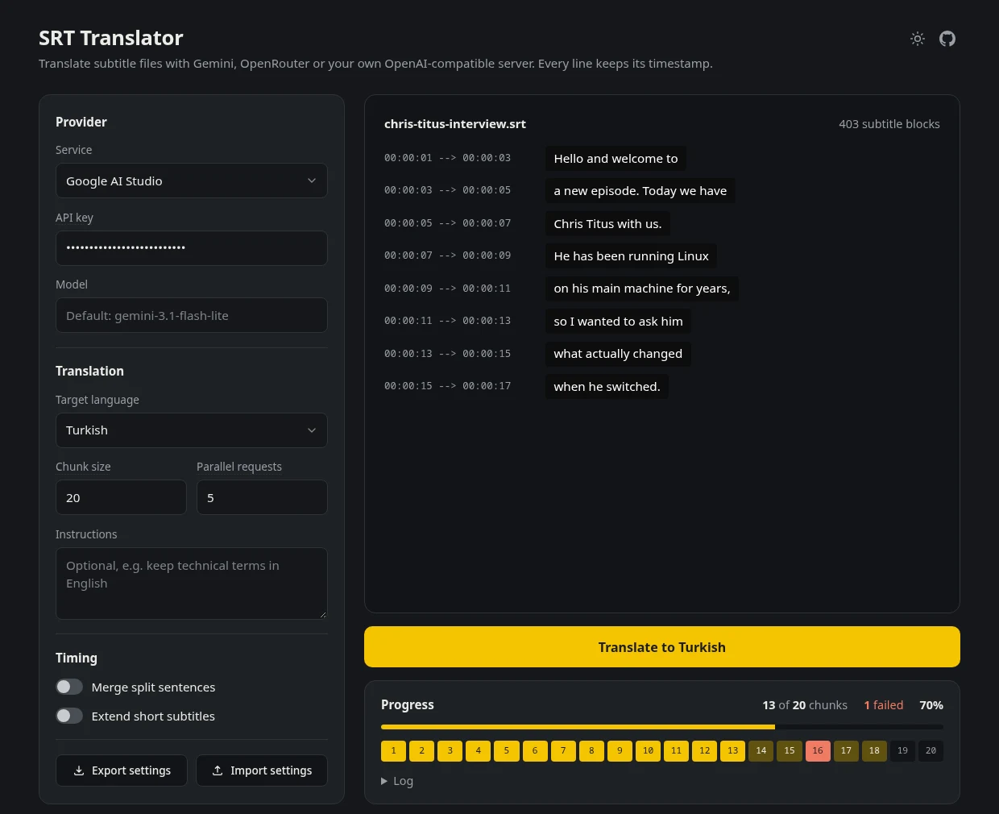

# SRT Translator

Translate `.srt` subtitle files with Gemini (Google AI Studio), any model on OpenRouter, or your own OpenAI-compatible server, right in your browser. Most subtitle translators either translate block by block, which breaks sentences that span several blocks, or translate whole sentences and leave some blocks empty. This one gives the model the full sentence and still puts every piece of the translation back on its original timestamp.



## Usage

1. Open `index.html` in a browser. There is nothing to install or build.
2. Pick a provider and paste its API key ([Google AI Studio](https://aistudio.google.com/app/apikey) or [OpenRouter](https://openrouter.ai/keys)). For OpenAI-compatible, enter the base URL (e.g. `http://localhost:11434/v1` for Ollama). Pick a model from the list the provider returns or type one; the server must allow browser requests (CORS).
3. Drop `.srt` files or a whole folder, choose the target language and click Translate. Files are translated one after another.
4. Download each file as it finishes, or all of them as one ZIP. Failed chunks keep their original text, so a file is always complete, and a file that fails entirely does not hold up the rest.

To translate a whole folder from the terminal, run `node scripts/translate-srt.mjs --help` (Node.js 18 or newer, no dependencies); `node scripts/wrap-srt.mjs file.srt` only breaks long lines, without translating.

The default model is `gemini-3.1-flash-lite` (`google/gemini-3.1-flash-lite` on OpenRouter). Leave Parallel requests at 5 on the Gemini free tier to stay under its rate limit; paid keys can go higher. Rate-limited requests wait out the cooldown Google reports and retry on their own.

## How it keeps timing

Subtitles split one sentence across several blocks, and languages order words differently (English puts the verb in the middle, Turkish at the end). Translate the sentence as a whole and the model tends to pour it all into the first block:

```
[00:01] I will not   →  [00:01] Bunu yapmayacağım
[00:02] do this.     →  [00:02]
```

Translate each block on its own instead and the model never sees the sentence, so the fragments come out stiff and in the wrong word order. This app sends whole sentences but tags every block with a marker, and the model has to return the same markers:

```
[B1] Hello and welcome to          →  [B1] Merhaba ve yeni bir
[B2] a new episode. Today we have  →  [B2] bölüme hoş geldiniz. Bugün yanımızda
[B3] Chris Titus with us.          →  [B3] Chris Titus var.
```

The translation stays natural and every block gets its share back on its own timestamp. A block whose marker does not come back keeps its original text instead of shifting the rest. Chunks of about 20 blocks end on a sentence ending when one is close, and run in parallel.

Three optional switches, all off by default, shape the file: Merge split sentences folds a short trailing fragment into the previous block, Extend short subtitles lengthens blocks shown for under about 1.3 s, and Break long lines splits translated lines over 42 characters into balanced lines. Arabic and Persian output gets RTL punctuation and bidi markers so players like VLC render it correctly.

## Privacy

Your API key is stored in your browser's `localStorage` (Export settings writes it to a JSON file in plain text, so keep that file private). Only subtitle text is sent, and only to the provider you picked. Use an `https` base URL for any server that is not on your own machine, or the key travels unencrypted.

## License

GPL-3.0
